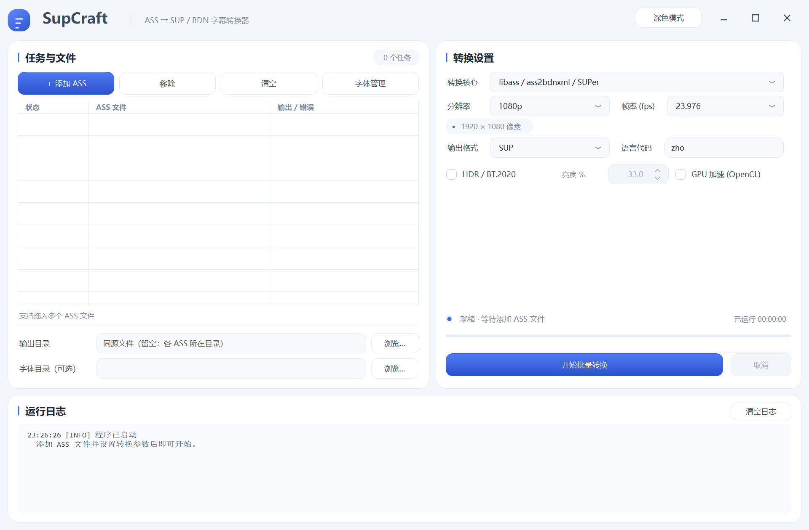
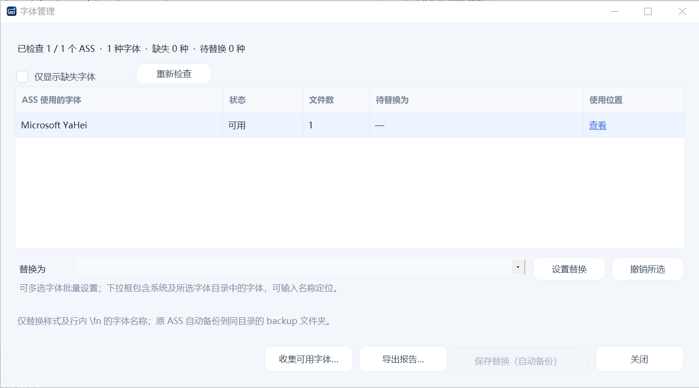

# SupCraft v0.8

ASS → SUP / BDN 图形字幕批量转换器，由 Codex 编写。

- Windows 提供 **libass / SUPer** 和 **AviSynth / VSFilterMod** 两条转换路线，默认使用 libass。
- 支持 SUP、BDN XML + PNG，以及两者同时输出。
- 支持免安装字体目录、缺失字体检查和批量字体替换；修改前自动备份原 ASS。

- 提供浅色 / 深色界面、完整路径提示和已运行时长显示。

## 快速开始

1. 解压运行包，打开 `SupCraft.exe`，保留旁边的 `tools/` 文件夹。
2. 添加或拖入 ASS；输出目录留空时，结果保存到每个 ASS 自己所在的目录。
3. 如有配套字体，选择字体目录，通过“字体管理”检查或替换缺失字体。
4. 选择核心、分辨率、帧率和输出格式，点击“开始批量转换”。

## 平台与环境

- **Windows：**运行包附带转换组件，无需另装 Python。SUPer 需要 64 位 Windows；AviSynth 路线另需安装 **32 位 AviSynth+**。
- **macOS：**提供 Apple Silicon 版本，仅使用 libass / SUPer；详见 [Mac 说明](macos/README.md)。

高分辨率、自定义尺寸、HDR 和渲染器差异见使用说明；请按目标视频设置帧率，并抽查转换结果。

## 文档与开发

- [使用说明](docs/USAGE.md)：参数、字体管理、输出位置与常见问题。
- [核心与选项详解](docs/MODES-AND-OPTIONS.md)：两条路线、输出开关和 GPU 行为。
- [构建与维护](docs/DEVELOPMENT.md)：源码结构、构建、打包与检查命令。

Windows 源码构建：`powershell -ExecutionPolicy Bypass -File .\build.ps1`。输出为 `app/SupCraft.exe`。

## 授权与第三方组件

SupCraft 独立自有部分采用[免费使用与禁止转售许可](LICENSE)：**允许个人及商业项目使用，禁止售卖或收费分发软件及修改版**。源码可查看、修改和免费分发；这是自定义许可，不属于 OSI 定义的开源许可。

第三方组件及其修改版保留原许可，`macos/runtime/` 独立适配文件继续采用 0BSD。此次变更不追溯撤回已授予的旧版许可。

组件、作者及授权范围见[第三方声明](THIRD-PARTY-NOTICES.md)；许可原文、来源索引和修改记录集中在 [legal/](legal/SOURCES.md)。
